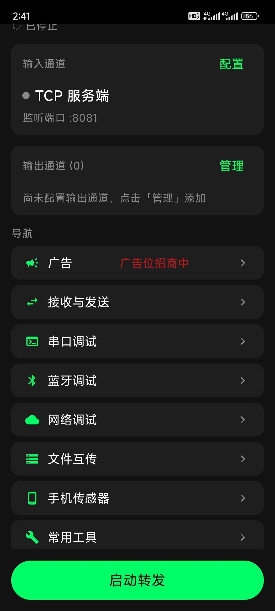
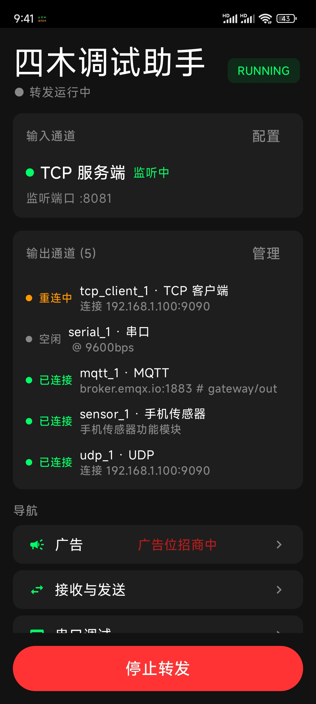
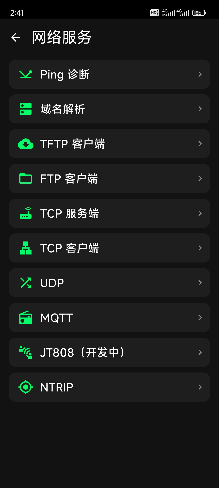
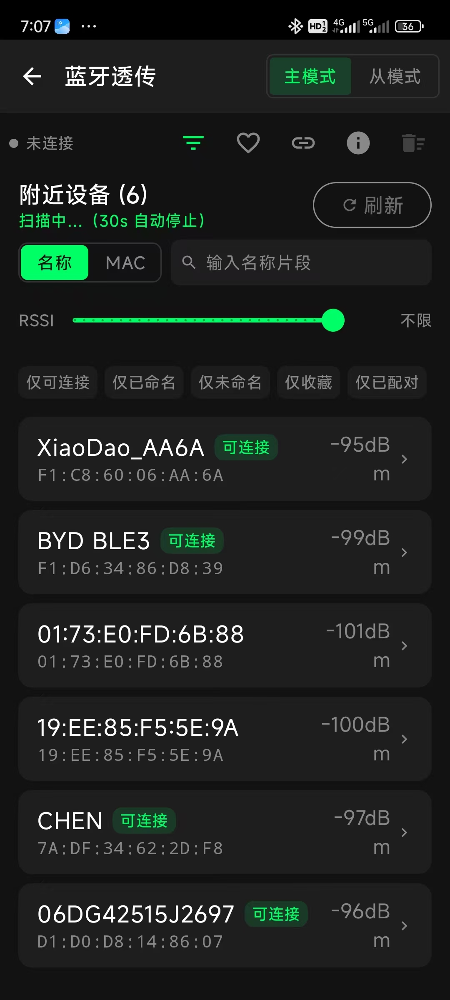
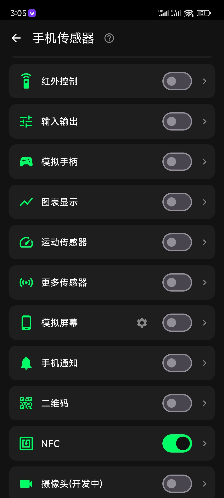
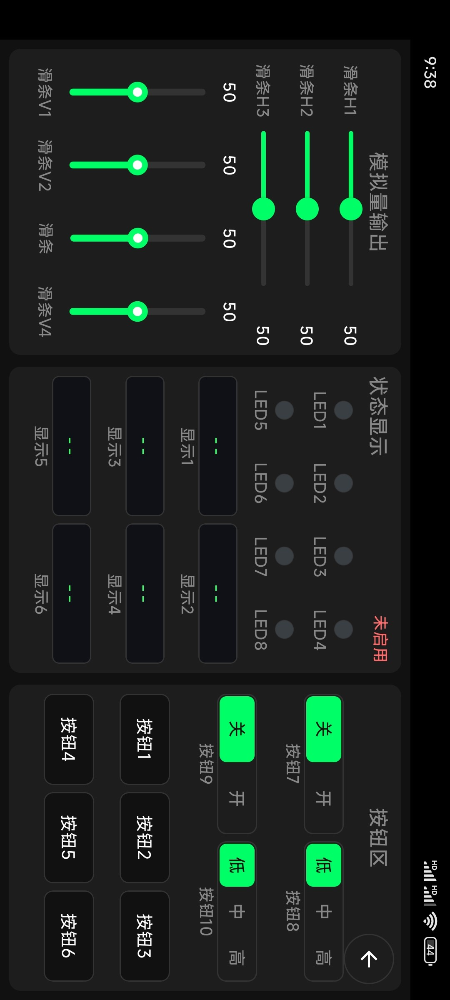

  <h1> Fwood Assistant</h1>
  <h3>—— A debugging workbench in your pocket for embedded engineers ——</h3>
  
<a href="./readme.md">中文</a> | <strong>English</strong>

An embedded debugging tool running on **Android**. `One phone covers the whole on-site debugging workflow`.

It supports **serial port**, Bluetooth, network, IR debugging, **data forwarding**, phone sensor reading, file transfer and protocol interaction.

## Get the App

- Download from the official site: <https://theboynoname.cn>

## Features

### 1. Serial Port Debugging

- Send / receive data as HEX or text, save received data to a file, and other basics
- AT commands, plus common protocols such as ymodem and modbus
- Command history and quick commands, with one-click import of all commands
- Receive filtering, both simple matching and regular expressions
- Quick input shortcuts for typing all kinds of commands fast

### 2. Bluetooth Debugging

- Central mode: scanning, connecting, sending / receiving, packet assembly, RSSI tracking, etc.
- Peripheral mode: send and receive custom frames
- Fuzzy or exact filtering by name / MAC, plus combined filters such as connectable only, named only, favorited only, paired only

### 3. Network Debugging

- Common protocols: tcp, udp, mqtt, ntrip, jt808
- Utilities such as ping and DNS lookup
- File transfer over ftp and tftp

### 4. Data Forwarding

- Inputs: serial port, Bluetooth and other communication channels
- Outputs: serial port, Bluetooth, network and other communication channels
- Multiple outputs at the same time
- Data can be sent back to the input side
- Typical uses:
  - Devices without network access borrow the phone's connection to exchange data
  - Data distribution to several destinations

### 5. Protocol Interaction

- Status display and control
  - Show device status on the phone UI
  - Control the device from the phone UI
- TTS voice announcements and notifications
  - The device can push voice announcements and notifications to the phone via the protocol
- Chart display
  - Render data as waveforms and other charts
- Virtual screen
  - The device borrows the phone screen for its UI

### 6. Phone Sensors, File Transfer and IR Control

- Phone sensor reading: accelerometer, gyroscope, magnetometer, barometer, ambient light and more, in real time
- File transfer: HTTPS file exchange between PC and app, no extra tooling needed
- IR control: send custom IR frames

### 7. Other

- UI language: Chinese and English
- Theme: light and dark
- Character encoding: UTF-8, GB2312, ASCII

## Screenshots

| Home | Forwarding Channel | Network Debug |
| :--: | :--: | :--: |
|  |  |  |
| BLE Home | Phone Sensors | I/O Control |
|  |  |  |

## Protocol Document

- [`手机传感器协议.md`](./手机传感器协议.md) (Chinese only): Phone Sensor Protocol. It turns the phone into a peripheral of the embedded device: the device borrows the phone's screen, speaker and charts to talk to the user, while the phone sends actions back with a virtual gamepad and buttons. When there is no host PC and no ribbon cable on site, one phone replaces a display and a keypad — watch waveforms, hear announcements, tweak parameters, press a few keys, without carrying a laptop. The device side only emits frames per the protocol; all display and interaction happen on the phone, so the firmware can drop a screen and a pile of buttons and the enclosure no longer has to be reworked for every revision.

## Contact

| Channel | Details |
| :-- | :-- |
| WeChat | `simucoreTech` |
| QQ Group | `1125592363` |
| Website | <https://www.theboynoname.cn> |

<table>
  <tr>
    <td align="center">WeChat QR </td>
    <td align="center">QQ Group QR </td>
  </tr>
</table>

---

Author: 四木留痕 (fwood)　|　App: Fwood Assistant (四木调试助手)
