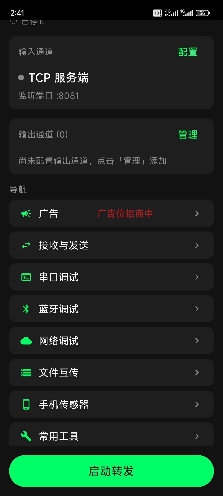
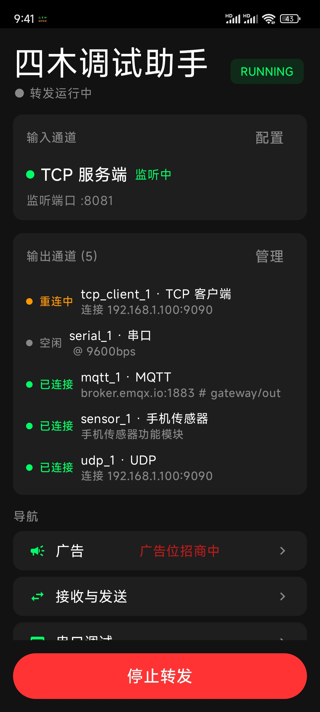
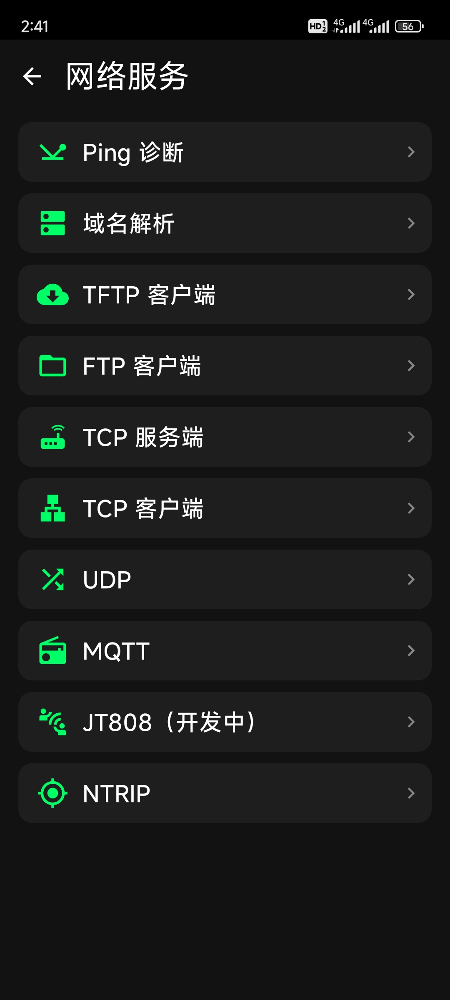
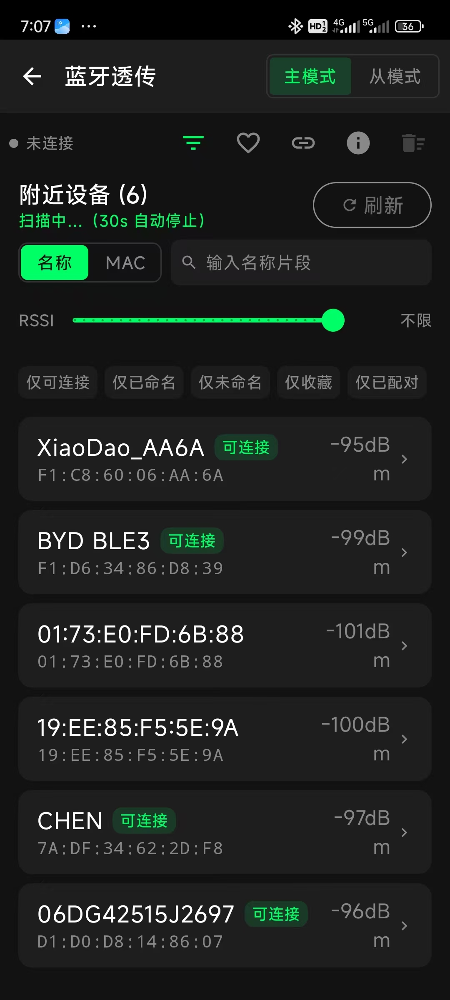
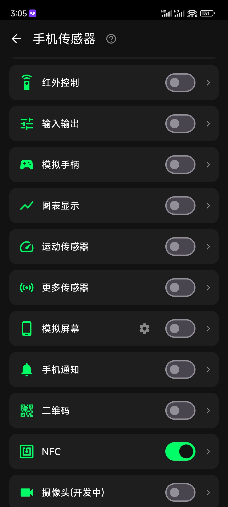
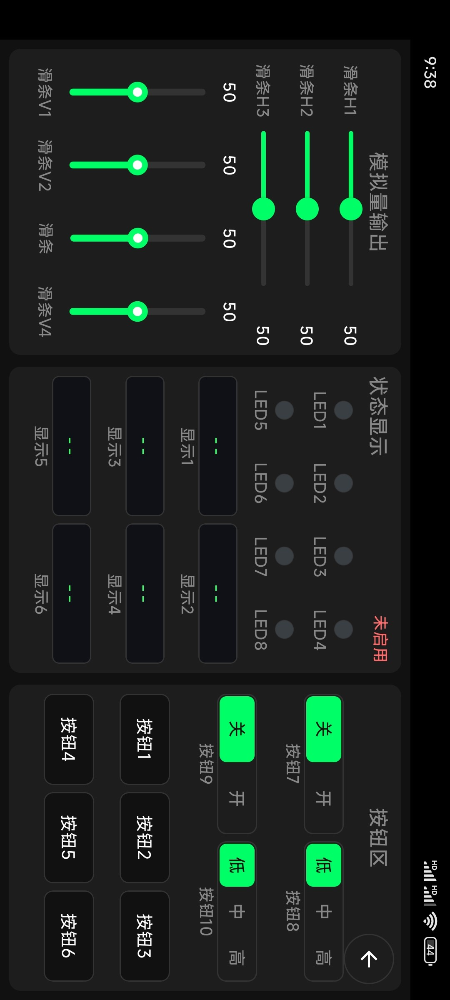

  <h1> 四木调试助手</h1>
  <h3>—— 嵌入式工程师的随身调试工作台 ——</h3>

运行于 **Android** 的嵌入式调试工具。支持**串口**、蓝牙、网络、红外调试、**数据转发**、手机传感器读取、文件互传、协议交互。`一台手机覆盖现场调试全流程`。

## 获取 App

- 官网获取：<https://theboynoname.cn>

## 功能

### 1. 串口调试

- 支持发送、接收数据 HEX/文本显示，保存到文件等基础功能
- 支持 AT 命令，ymodem、modbus 等常用协议
- 支持历史指令、快捷指令，支持一键导入所有指令
- 支持接收过滤，支持简单过滤和正则过滤
- 支持快捷输入，方便快速输入各种指令

### 2. 蓝牙调试

- 主机模式支持扫描、连接、收发、组包、RSSI 信号跟踪等
- 从机模式支持发送接收自定义帧
- 支持按名称/MAC 等模糊或精准过滤，支持按仅可连接、仅已命名、仅收藏、仅配对等组合过滤

### 3. 网络调试

- 支持 tcp、udp、mqtt、ntrip、jt808 等常用协议
- 支持 ping、域名解析等常用工具
- 支持 ftp、tftp 文件传输等

### 4. 数据转发

- 支持串口、蓝牙等多种通信方式作为输入端
- 支持串口、蓝牙、网络等多种通信方式作为输出端
- 支持多个输出端
- 支持数据回传
- 主要用途：
  - 无联网能力的设备借用手机网络联网进行数据交互
  - 数据分发

### 5. 协议交互功能

- 状态显示及控制
  - 支持将设备状态显示到手机 UI 界面
  - 支持通过手机 UI 控制设备
- TTS 语音播报及通知发送
  - 支持设备通过协议给手机发送语音播报及通知
- 图表显示功能
  - 支持将数据显示为波形等
- 模拟屏幕功能
  - 设备可以借用手机屏幕进行 UI 显示

### 6. 手机传感器、文件互传与红外控制

- 手机传感器信息读取：支持将加速度、陀螺仪、磁力计、气压、光线等传感器数据实时读取
- 文件互传：支持 https 文件互传，简化 PC 与 app 的文件传输
- 红外控制：支持发送自定义红外帧

## 界面

| 主页 | 转发通道 | 网络调试 |
| :--: | :--: | :--: |
|  |  |  |
| 蓝牙主页 | 手机传感器 | 输入输出控制 |
|  |  |  |

## 协议文档

- [`手机传感器协议.md`](./手机传感器协议.md)：让手机变成嵌入式设备的外设：设备借用手机的屏幕、喇叭、图表与人对话，手机用模拟手柄、按钮把操作回传给设备。现场没有上位机、没有排线时，一台手机顶替一块显示屏和一副按键——看波形、听播报、临时改参数、按几下按键，不必再搬笔记本。设备侧只按协议发帧，展示与交互都交给手机，固件里省掉一块屏和一堆按键，结构件也不必跟着版本反复改版。

## 联系方式

| 渠道 | 内容 |
| :-- | :-- |
| 微信 | `simucoreTech` |
| QQ 交流群 | `1125592363` |
| Gitee | <https://gitee.com/fwoodtech/fwoodassist> |

<table>
  <tr>
    <td align="center">微信二维码 </td>
    <td align="center">QQ 群二维码 </td>
  </tr>
</table>

---

作者：四木留痕　|　app：四木调试助手
